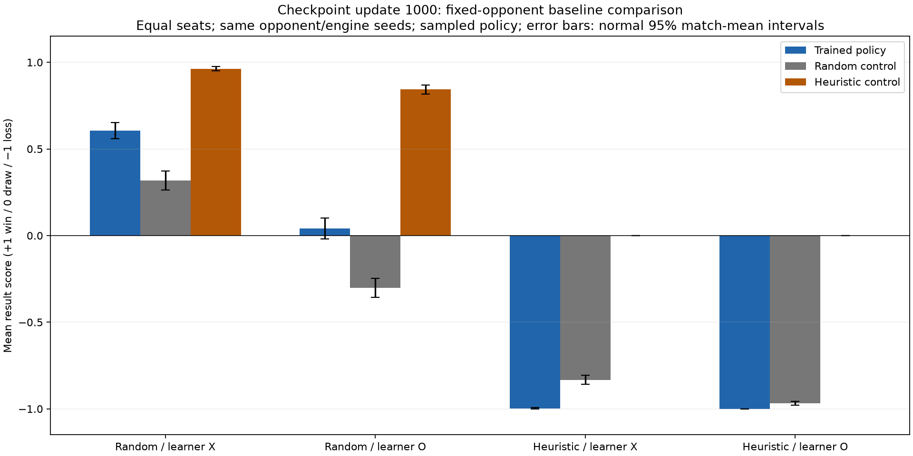
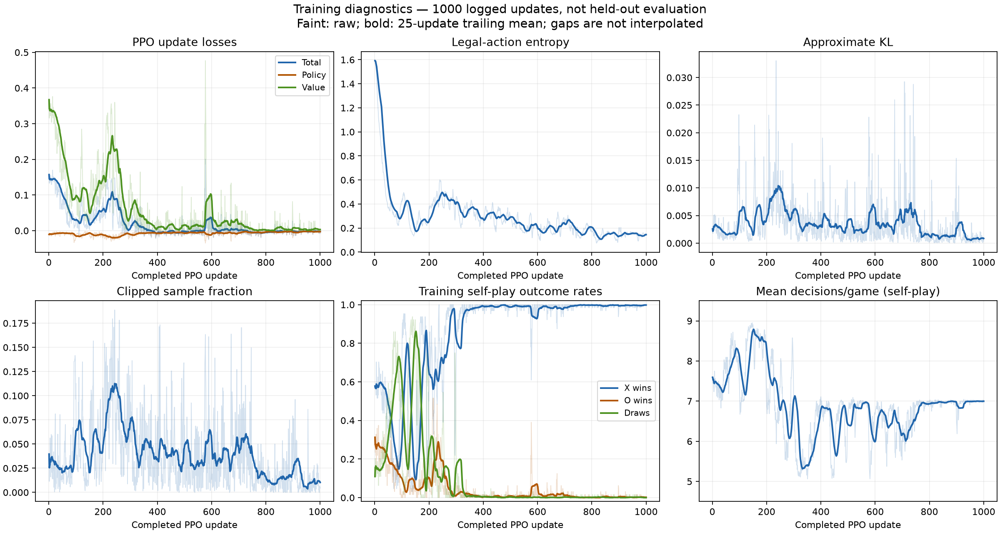

# Phase 4 results and acceptance

This report records Phase 4's matched controls, training curves and bounded
acceptance evidence. Completed on 2026-10-15: all eight Phase 4 tasks are
implemented and tested. The recorded training run used 1,000 CUDA PPO updates
(64,000 self-play games, seed 42); analysis performed no further training and did
not change the checkpoint or training log.
Checkpoint identity and the original 4,000-game protocol are in
[policy evaluation](POLICY_EVALUATION.md).

**Historical follow-up:** the weakness measured here motivated
[Phase 4.5's completed investigation](../../PHASE45_RESULTS.md), including diagnosis,
checkpoint monitoring and a bounded learning comparison. The measurements below
remain the original Phase 4 results. Training stays latest-policy self-play only;
fixed opponents here are evaluation tools, not teachers or training experience.
This report alone establishes no causal diagnosis, repair or perfect-play claim.

## Matched baseline comparison

The sampled frozen policy and random/heuristic controls each played the same four
fixed-opponent/seat cases with 1,000 games per case: 12,000 games total. Root seed
20261015, start index zero, X-first engine rules, independent evaluation namespace.
Controls replace only the learner; engine and opponent seeds match per game.
Identical seeds do not imply identical trajectories when actions differ.
Every match completed with no errors or truncations. Policy results exactly
reproduced Task 7. Scores are +1 win / 0 draw / -1 loss.

| Opponent / learner seat | Policy score | Random control | Heuristic control |
|---|---:|---:|---:|
| Random / X | +0.606 | +0.318 | +0.963 |
| Random / O | +0.041 | -0.303 | +0.843 |
| Heuristic / X | -0.997 | -0.833 | 0.000 |
| Heuristic / O | -1.000 | -0.968 | 0.000 |

Against random opponents, the trained policy wins 62.7% of the balanced 2,000
games, compared with 44.0% for the random control. The primary equal-seat
mean-score improvement is **+0.3160**, approximate 95% interval **[+0.2644,+0.3676]**.
Compute score differences for each paired match; average the two seat means.
Stratified standard error is 0.5*sqrt(SE_X²+SE_O²), and the interval uses ±1.96 SE.
This uncertainty describes match RNG for one frozen checkpoint, not variability
across training runs. The primary interval is exploratory evidence for this
checkpoint/protocol, not an adjusted family of tests or an optimal-play claim.



## Training curves

All 1,000 update rows are present, ordered, and finite. Raw curves are faint;
25-update trailing means are bold. Missing updates would break lines and reset
smoothing; the actual log has no gaps. These are training self-play diagnostics,
not intermediate held-out strength measurements (earlier checkpoints were not retained).

| Diagnostic | First 25 updates | Last 25 updates |
|---|---:|---:|
| Mean value loss | 0.3260 | 0.0032 |
| Mean legal-action entropy | 1.2087 | 0.1455 |
| Self-play X win rate | 59.19% | 99.81% |
| Self-play O win rate | 25.88% | 0.19% |
| Self-play draw rate | 14.94% | 0.00% |



Loss/entropy fell while self-play became almost entirely X wins. Held-out tests
show that this did not produce robust defense: the policy loses nearly every
heuristic matchup and performs worse there than random controls. This is
consistent with self-play specialization; the causal mechanism is not diagnosed.
No configuration or model was silently repaired or retrained.

## Acceptance and limits

**Phase 4's minimal criterion is met for this reproducible checkpoint/protocol:**
independent, balanced evaluation shows measurable improvement over a random
policy control, with a positive approximate interval lower bound and >=30 games
per seat. This does not establish repeatability of training quality across seeds,
robustness against the heuristic, or optimal play. These weaknesses should remain
visible when choosing future work. Fresh final-test seeds are needed if this
suite becomes a tuning target. No search or Phase 5 mechanics were added.

## Reproduction and files

```powershell
.\.venv\Scripts\python.exe -m pip install -e ".[analysis]"
.\.venv\Scripts\python.exe -m boardgame_ai analyze runs/tic-tac-toe-cuda/latest.pt --output runs/phase4-analysis-rerun --games-per-seat 1000 --seed 20261015
```

Analysis output must be separate and absent/empty; it contains comparison.json,
training-summary.json, and PNG/SVG versions of both figures. The training log
hash and checkpoint hash bind the inputs. Charts were visually inspected.
Tracked figure copies live in docs/phase4; generated JSON, logs, and model weights
stay ignored under runs. Python 3.12.14, PyTorch 2.14.1+cu130, Matplotlib 3.11.2
were used; evaluation/plots run on CPU. The subsequent read-only tactical and
learning-signal diagnosis is recorded in [POLICY_DIAGNOSIS.md](POLICY_DIAGNOSIS.md).
Policy robustness remains unresolved; see [current status](../../PROGRESS.md) for the
next milestone.
